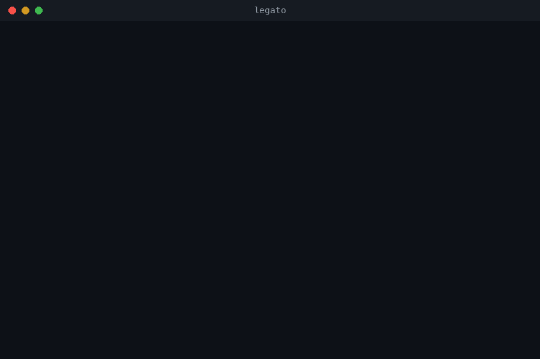
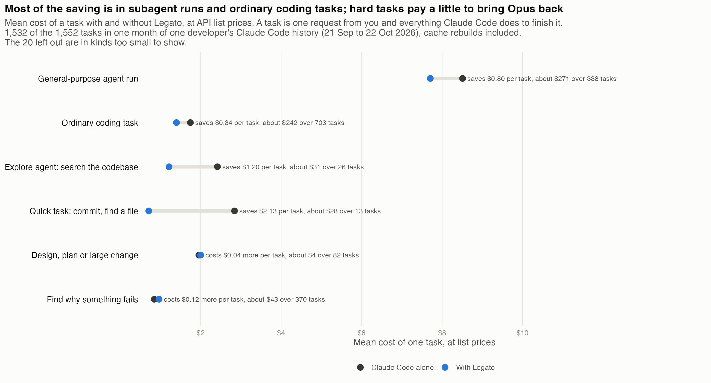
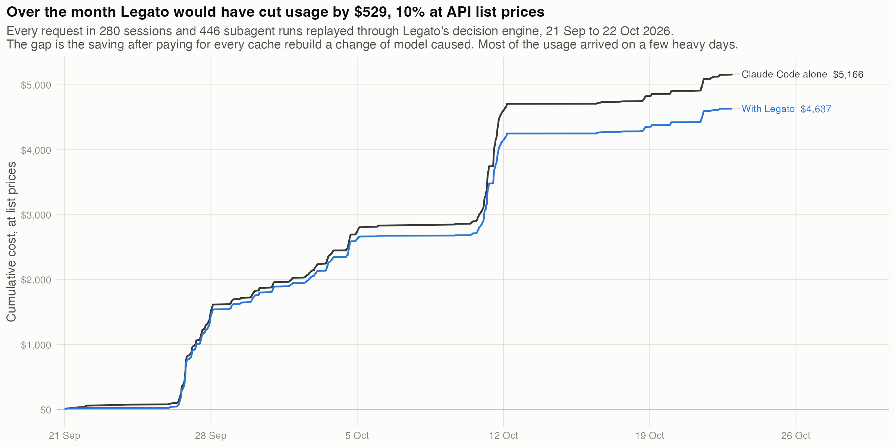

# Legato

> *Legato is an Italian musical term meaning "tied together" that indicates notes should be played or sung smoothly and continuously with no silence or gap between them.*

Legato runs Claude Code and chooses, for each task, which Claude model answers and how hard it thinks. Quick tasks go to Haiku, ordinary ones to Sonnet, hard ones to Opus, when the change pays. Each model keeps its own cached copy of the conversation, so changing model partway through a long conversation costs money, and Legato changes model only when it has worked out that the saving covers that cost.

## Demo



A real session, replayed from Legato's log. A greeting goes to Sonnet, a four-stage task with three subagents goes back to Opus, and a question afterwards goes to Sonnet again because Opus's cache had expired. The status line at the bottom says what ran and what it saved. Then one month of real use, replayed. The same film as video: [docs/demo.mp4](docs/demo.mp4).

## Quick start

```bash
npm install -g github:joelalcedo/legato
legato
```

Needs Node 20 or newer and Claude Code. `legato` starts the proxy, adds the status line, and launches Claude Code as "Dynamic mode". Claude Code's own arguments pass through: `legato --resume`.

```bash
legato analyze --since 30d --html report.html    # what Legato would have saved on your own history
legato explain "add a loading state" --context 180000 --effort xhigh   # one decision, with the arithmetic
legato start --mode shadow                       # decide and log, but send every request as is
```

Nothing leaves your machine except the API calls Claude Code already makes.

## How it works

Legato is a local proxy between Claude Code and the API. For every request it reads the conversation, picks a model and an effort, rewrites the request when that saves money, and streams the answer back.

Effort is Claude Code's setting for how long a model thinks before it answers. Legato changes it on every task, and that costs nothing: a rename runs at medium instead of xhigh, a hard question keeps your setting, and nothing in the conversation changes, so the cache stays warm.

The model changes only when the change is free or pays for itself. It is free at the start of a conversation, at the start of every subagent (a side task Claude Code spins off), after Claude Code compacts the conversation, after the cache has expired, and while the conversation is still small. Otherwise Legato changes model only when the saving over the next few requests beats the cost of rebuilding the cache. Hard tasks, plan mode and a task that follows a failure go to Opus regardless. Side agents are routed by kind: the Explore agents Claude Code uses to search a codebase run on Sonnet, and a fork, which inherits its parent's whole conversation, stays on the parent's model.

Claude Code's header says `Dynamic mode`. The status line says what each task ran on:

```
Legato: chose Haiku 5.5 for this task, using low effort instead of xhigh · saved $0.70 this session
Legato: switched from Opus 5.5 to Sonnet 5.5 for this task, using medium effort instead of xhigh · saved $0.58 this session
Legato: staying on Opus 5.5 for this task, using medium effort instead of xhigh (a switch to Sonnet 5.5 would cost $0.39 more than it saves) · saved $1.15 this session
```

"Saved" is what the same requests would have cost, at API list prices, on the model Claude Code asked for. If the API rejects a rewritten request, Legato sends it once more exactly as Claude Code wrote it. Every decision is logged with its reasons in `~/.legato/decisions.jsonl`.

## Saving examples

A task is one request from you and everything Claude Code does to finish it. These are mean costs over one month of one developer's real Claude Code history, replayed through Legato's decision engine, charging for every cache rebuild a change of model caused.



An ordinary coding task costs $1.74 without Legato and $1.40 with it. A general-purpose subagent run costs $8.51 without and $7.71 with. On the two hard kinds Legato costs more: 4¢ on a $1.95 design task and 12¢ on an 85¢ debugging task, because a hard task that arrives while the conversation is on Sonnet pays to bring Opus back. Legato pays that rather than leave a hard task on Sonnet.



Over the month, 280 sessions and 52,217 API requests, Legato would have cut usage from $5,166 to $4,637 at API list prices, a saving of $529 or 10%. This developer is on a Claude Max subscription, so these dollars measure usage rather than money paid; on pay-as-you-go API pricing they would be the bill. Part of the saving comes from sessions that began on Fable 5.1 and were moved to Opus at their first request; on sessions that began on Opus the saving is about 8%. Lower effort on the same model is not counted, because its effect on output length is an assumption. These are means over a lumpy month, so your own number will differ: run `legato analyze --since 30d` for it.

The arithmetic behind the switching rule, the full evaluation and the roadmap are in `docs/`.
