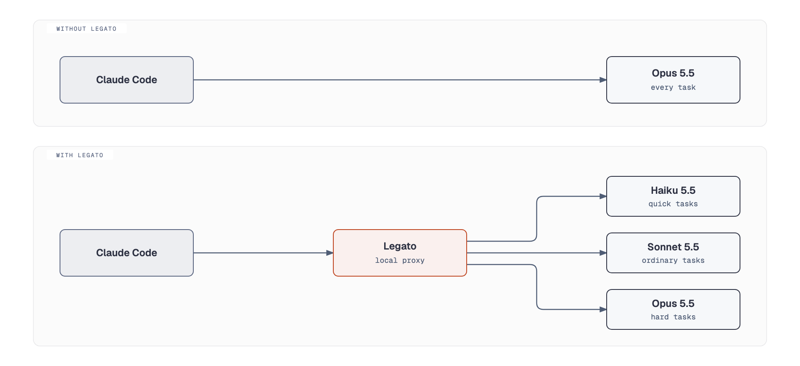
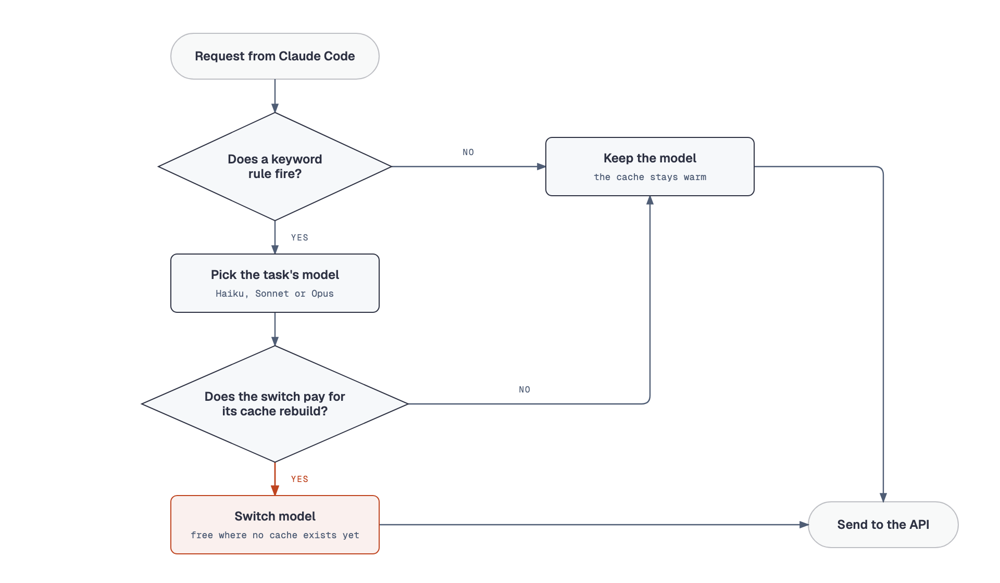
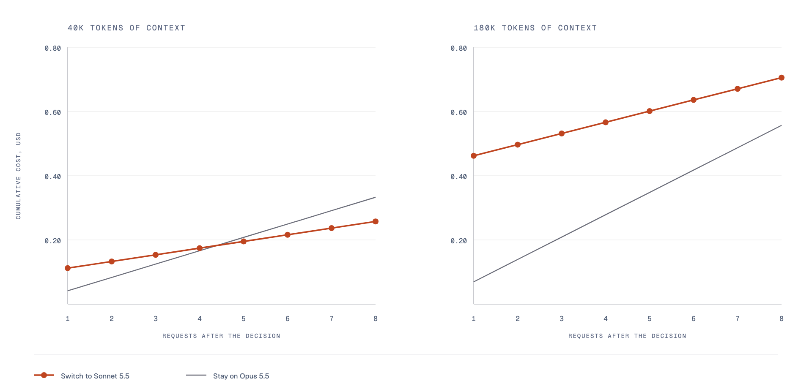

# Legato

> *Legato is an Italian musical term meaning "tied together" that indicates notes should be played or sung smoothly and continuously with no silence or gap between them.*

Cache-aware model routing for Claude Code. A local proxy sends each task to Haiku, Sonnet or Opus at the effort it needs, and switches model only when the saving covers rebuilding the prompt cache. Cursor and GitHub Copilot call this Auto. Claude Code has no native version ([#27665](https://github.com/anthropics/claude-code/issues/27665)). Cut usage by 10% on a month of real use at API list prices, cache rebuilds included.

## Quick start

```bash
npm install -g github:joelalcedo/legato
legato
```

Needs Node 20 and Claude Code. `legato` starts the proxy, adds a status line to `~/.claude/settings.json` on first use if you have none, and launches Claude Code as `Dynamic mode`. Claude Code's own arguments pass through, so `legato --resume` works.

Replay your own history to see what it would have saved. The report lists every task, the model it would have run on, and the cost either way.

```bash
legato analyze --since 30d --html report.html
```

Inspect one decision by giving `explain` a task, the size of the conversation and your `/effort` setting. It assumes the conversation is on Opus unless you pass `--current`.

```bash
legato explain "rename the helper to parseConfig and update its callers" --context 180000 --effort xhigh
```

```
Switch from Opus 5.5 to Haiku 5.5 for this task, using medium effort instead of xhigh.
  Looks like a quick task (a mechanical edit).
  Switching to Haiku 5.5: it saves about 5.6¢ on each of the next 8 requests ($0.45), costs 7¢ to rebuild the cache and about $0.27 to come back to Opus 5.5 later, so it comes out about $0.11 ahead.
  This assumes about 8 more requests on Haiku 5.5 and a 30% chance of coming back to Opus 5.5 after its cache has expired.
  Priced with the 5-minute cache, as on an API key. On a subscription the main thread uses the 1-hour cache: pass --ttl 3600 to see that case.
```

Shadow mode logs the decision for every request and sends it exactly as Claude Code wrote it. Start it in one terminal and run `legato` in another.

```bash
legato start --mode shadow
```

Nothing leaves your machine except the API calls Claude Code already makes.

## Demo

A real session through Legato, with the status line reporting each switch, then a month of real use replayed.


## How it works

Claude Code sends every request to the proxy, which forwards it on the model and effort the task needs.

<picture>
  <source media="(prefers-color-scheme: dark)" srcset="docs/diagrams/architecture-dark.png">
  
</picture>

Keyword rules in `src/classifier.ts` read each task: "root cause" and "race condition" mean hard, "rename", "commit" and a greeting mean quick, and every rule that fires is printed with the decision. When no rule fires, the task stays on its model. A switch is free where no cache exists yet: a conversation's first request, a subagent's first request, or the request after Claude Code compacts a long conversation. Nine switches in ten in the month below were free.

<picture>
  <source media="(prefers-color-scheme: dark)" srcset="docs/diagrams/decision-dark.png">
  
</picture>

Effort is set on every request: a hard task keeps your setting, other tasks run at low, medium or high by how strongly the rules fired, a task no rule reads runs one step down, and nothing goes above your setting. Effort is free, since it rides on a small message at the end of the request and leaves the cached conversation untouched. A model switch is not free. Each model keeps its own cache of the conversation, so switching partway through pays to rebuild it before saving anything. The chart shows the same Opus to Sonnet switch at 40K and 180K tokens of context, at list prices.

<picture>
  <source media="(prefers-color-scheme: dark)" srcset="docs/diagrams/switch-cost-dark.png">
  
</picture>

At 40K the switch pays for itself by the fifth request. Legato also charges a 30% chance of paying to come back to Opus later, which the chart leaves out, and the switch is still about 3¢ ahead after eight requests, so it switches. At 180K the rebuild alone costs more than eight requests on Sonnet save, so Legato stays on Opus, lowers the effort, and says so:

```
Legato: staying on Opus 5.5 for this task, using high effort instead of xhigh (a switch to Sonnet 5.5 would cost $0.39 more than it saves) · saved $1.15 this session
```

The last figure is the session's running total. Subagents are routed by type, independent of Claude Code's subagent model setting ([#43869](https://github.com/anthropics/claude-code/issues/43869)). Explore agents run on Sonnet. General-purpose agents and forks, which start with the parent's whole conversation, stay on the parent's model.

"Saved" is what the same requests would have cost on the model Claude Code asked for, at list prices: money on API billing, plan usage on a subscription. If the API rejects a rewritten request, Legato resends it as Claude Code wrote it. Legato cannot judge whether the cheaper answer was as good as the dearer one. Every decision and its reasons are logged in `~/.legato/decisions.jsonl` so that you can.

## Saving examples


One month of real use, replayed through Legato: $507 saved of $5,233 after paying for every cache rebuild. Ordinary coding tasks go from $1.50 to $1.03. Tasks the rules cannot read go from $1.84 to $1.38, since many sit on Sonnet after an earlier free switch. Hard tasks go from 87¢ to 77¢.

Usage at API list prices on a Max subscription. Sessions that start on Opus save about 8%. Lower effort on the same model is not counted. `legato analyze --since 30d` prints this table for your own history.

The arithmetic behind the switching rule, the full evaluation and the roadmap are in `docs/`.
