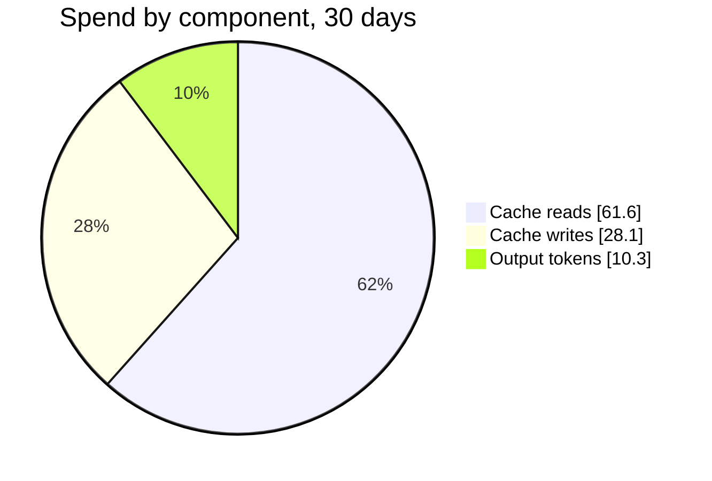
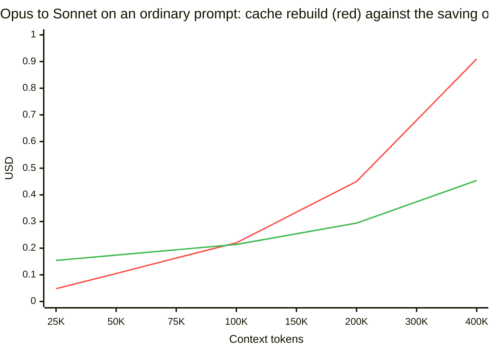
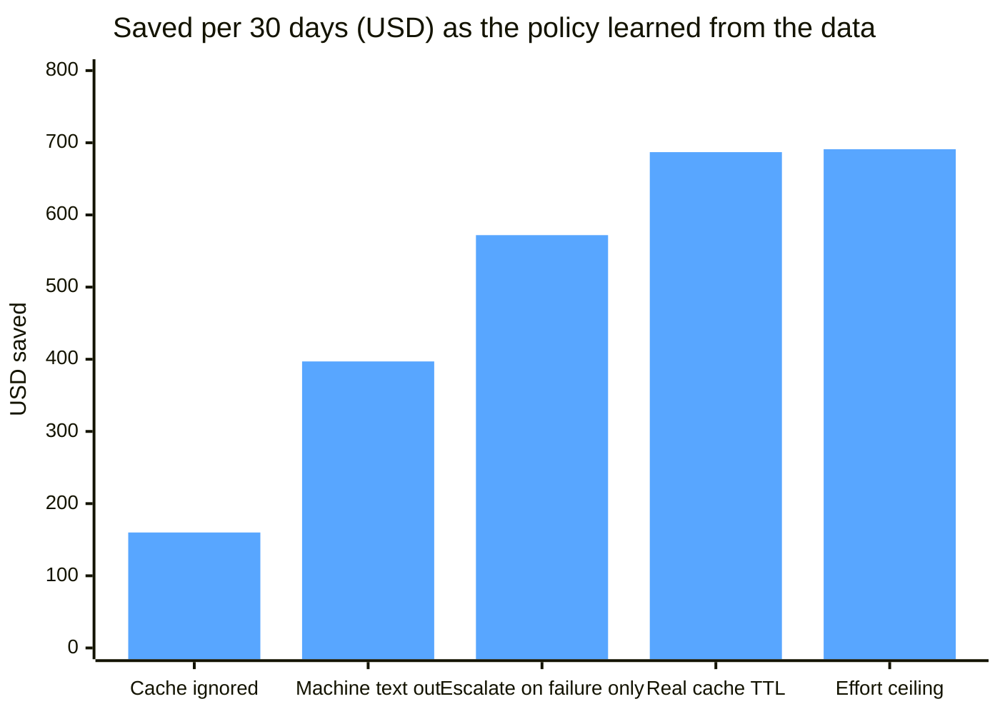

# Legato

> *Legato is an Italian musical term meaning "tied together" that indicates notes should be played or sung smoothly and continuously with no silence or gap between them.*

Claude Code, with the model and effort picked for every turn. Easy turns run on Haiku, normal ones on Sonnet, hard ones on Opus, and a switch happens only when the prompt-cache math says it pays.

## Demo


`legato explain` on the command line. The same prompt, two contexts: at 25K tokens the router switches to Sonnet; at 180K it keeps Opus and lowers the effort, because the cache rebuild would cost more than the switch saves. A hard prompt keeps Opus at full effort.

## Quick start

```bash
npm install -g github:joelalcedo/legato
legato
```

Node 20+ and Claude Code. `legato` starts the proxy, sets up the status line, and launches Claude Code as "Dynamic mode". Any Claude Code arguments pass through: `legato --resume`.

```bash
legato analyze --since 30d --html report.html      # what it would have saved on your own history
legato explain "add a loading state" --context 180000 --effort xhigh   # one decision, with the arithmetic
legato start --mode shadow                         # decide and log, but forward every request as sent
```

Nothing leaves your machine except the API calls Claude Code already makes.

## How it works

Legato is a local proxy between Claude Code and the API. For every request it reads the conversation, decides a model and an effort, rewrites the request when that pays, and streams the answer back.

Each model has its own prompt cache, and switching the main model mid-conversation re-reads the whole history uncached. On a 180K-token conversation, moving from Opus to Sonnet costs about $0.40 up front to save 3¢ a request. So the router has two gears:

- Effort, every turn. Legato appends a small effort message at the tail of the request. A rename runs at `medium` instead of `xhigh`; a hard question keeps your setting. Nothing in the history changes, so the cache and preserved thinking stay valid.
- Model, at cache boundaries. A switch happens at a user turn, never inside a tool loop, and only when it is free (the first request, every subagent's first request, after compaction, after the cache expired, a small context) or when `saving × expected run − rebuild − return cost` comes out positive. Upgrades for hard turns, plan mode and failing tasks go through.

Subagents are routed by what their system prompt says they are: Explore agents go to Sonnet. Forks are never switched. A downshift that would throw away the current model's thinking is held.

Claude Code's header reads `Dynamic mode`. The status line says what each turn ran on:

```
⇄ Dynamic mode: running on Haiku 5.5 at low effort · saved $0.70 over 1 turn
⇄ Dynamic mode: running on Opus 5.5 at medium effort (asked xhigh) · switch held: rebuild $0.97 · saved $1.15 over 20 turns
```

If the API rejects a rewritten request, the proxy retries with exactly what Claude Code sent. Every decision is logged with its numbers in `~/.legato/decisions.jsonl`.

## Saving examples

Numbers from replaying 30 days of one developer's real Claude Code history (267 sessions, 51,895 API requests, $5.1K at list prices) through the same engine, cache rebuilds included.

### Where the money goes



Cache reads are the bill. Output tokens, the part most people think about, are a tenth of it. That is why switching models carelessly loses money: a switch turns cheap reads into expensive writes.

### Where a switch stops paying



Below about 40K tokens the switch pays and Legato takes it. Above that it holds Opus and lowers the effort instead. Real sessions in the data averaged 387K tokens at each user turn.

### What each rule was worth



The first version switched on every turn and paid $752 in cache rebuilds to save $160. The current policy pays $89 and saves $691, which is 12.7%. On the following month, without Fable sessions, it saved $504, which is 9.9%; about 8% on sessions started on Opus.

| | Cache ignored | Cache-aware |
| - | - | - |
| Saved per 30 days | $160 (2.9%) | $691 (12.7%) |
| Cache rebuilds paid | $752 | $89 |
| Downshifts declined as not worth it | 0 | 498 |

What the replay cannot see is whether a cheaper model takes more turns to finish. `legato start --trial general-purpose=claude-sonnet-5-5/high:50` routes half of those subagents to Sonnet and logs the arm, so quality can be compared live. The arithmetic, the full evaluation and the roadmap are in `docs/`.
