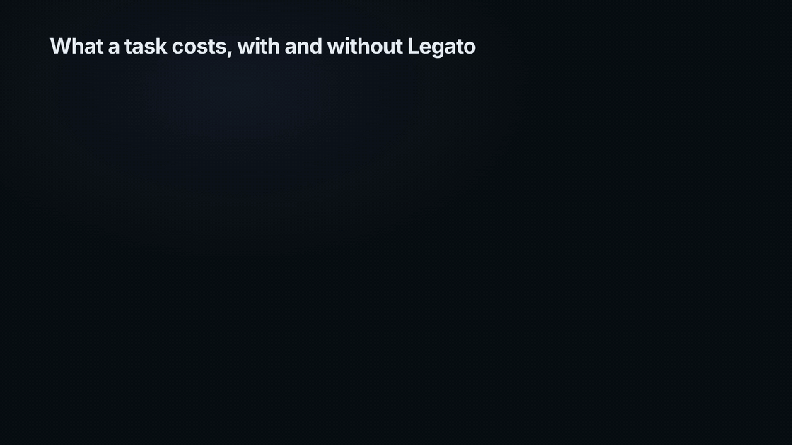

# Legato

> *Legato is an Italian musical term meaning "tied together" that indicates notes should be played or sung smoothly and continuously with no silence or gap between them.*

Cache-aware model routing for Claude Code. Legato runs Claude Code through a local proxy and routes each task to Haiku, Sonnet or Opus at the effort the task needs, switching model only when the saving covers the cost of rebuilding the prompt cache. Cursor and GitHub Copilot call this Auto. Claude Code has no native version ([#27665](https://github.com/anthropics/claude-code/issues/27665)). On one month of one developer's real use, Legato cut usage 10% at API list prices.

## Quick start

```bash
npm install -g github:joelalcedo/legato
legato
```

Needs Node 20 or newer and Claude Code. `legato` starts the proxy, adds the status line and launches Claude Code as `Dynamic mode`, since the model now varies by task. Claude Code's own arguments pass through: `legato --resume`.

```bash
legato analyze --since 30d --html report.html    # what Legato would have saved on your own history
legato explain "optimize the table rendering" --context 180000 --effort xhigh   # one decision, with the arithmetic
legato start --mode shadow                       # decide and log, but send every request as is
```

Nothing leaves your machine except the API calls Claude Code already makes.

## Demo

A real session replayed through Legato's router, with the status line reporting each switch, then one month of real use replayed.


## How it works

Legato is a local proxy between Claude Code and the API. For every request it reads the conversation, chooses a model and an effort, rewrites the request when that saves money, and streams the answer back.

What kind of task it is comes from a short list of keyword rules you can read in `src/classifier.ts`: "root cause" and "race condition" point to a hard task, "rename", "commit" and a greeting point to a quick one, and every rule that fires is printed with the decision. When no rule fires, Legato does not guess: the task stays on the model the conversation is on, one effort step below your setting. In the month below that was 42% of tasks. A hard verdict goes to Opus for free at a cache boundary; paying to rebuild a warm cache takes two hard rules, a task that just failed, or plan mode. A leading `//o` forces Opus for one task. No model and no network call sits in that path; `--classifier haiku` asks Haiku 5.5 instead, with an API key.

Effort is Claude Code's setting for how long a model thinks before it answers. Legato lowers it on easy tasks and keeps your setting on hard ones. That costs nothing, because nothing in the conversation changes and the cache stays warm.

A switch of model is different. Each model keeps its own cached copy of the conversation, so a switch partway through a long conversation pays to rebuild that cache. Where no cache exists yet the switch is free. Where one does, Legato switches only when the saving over the next few requests beats the rebuild, and when it declines a switch the status line says why:

```
Legato: staying on Opus 5.5 for this task, using medium effort instead of xhigh (a switch to Sonnet 5.5 would cost $0.39 more than it saves) · saved $1.15 this session
```

Subagents are routed at the proxy by what they are, whatever Claude Code's own subagent model setting does ([#43869](https://github.com/anthropics/claude-code/issues/43869)): Explore agents run on Sonnet, and general-purpose agents stay on the parent's model until a live trial shows Sonnet holds up. A fork, which inherits its parent's whole conversation, stays on the parent's model.

"Saved" is what the same requests would have cost, at API list prices, on the model Claude Code asked for. If the API rejects a rewritten request, Legato sends it once more exactly as Claude Code wrote it. Every decision is logged with its reasons in `~/.legato/decisions.jsonl`.

## Saving examples



One month of one developer's real Claude Code use, replayed through Legato: $507 saved of $5,233, after paying for every cache rebuild. A task that reads as ordinary coding goes from $1.50 to $1.03. One the rules cannot read stays on its model at one effort step down, and still goes from $1.84 to $1.38, because many of those sit on Sonnet after an earlier free switch. Hard tasks go from 87¢ to 77¢.

The dollars are usage at API list prices on a Max subscription. On sessions that start on Opus the saving is about 8%. Lower effort on the same model is not counted. `legato analyze --since 30d` prints this table for your own history.

The arithmetic behind the switching rule, the full evaluation and the roadmap are in `docs/`.
